# Transiciones entre pantallas — NovaCore · Misión Robots

Este documento describe la máquina de estados de pantallas de la experiencia. Se construyó
leyendo el código real (`src/router.ts`, `src/main.ts`, `src/ui/header.ts`, `src/ui/modal.ts`,
`src/store.ts` y `src/screens/*.ts`), no solo el README. Cada transición indica su disparador
y la línea exacta donde se llama a `go()`.

**Cómo funciona el router** (`src/router.ts`):

- `go(to, params)` (router.ts:133) cambia de pantalla. Si ya hay un cambio en curso (`busy`),
  la petición queda en `pending` y solo se ejecuta la **última** (router.ts:134-137, 192-196).
- `TRANSITIONS` (router.ts:46-62) **no bloquea** nada: `run()` solo hace `console.warn` si la
  transición no está declarada (router.ts:145). Es documentación verificable, no un guardián.
- La pantalla anterior se desmonta (`unmount`) antes de montar la nueva; sale con
  `.screen--leave` y entra con `.screen--enter` (fade de 450 ms, 120 ms con reduced-motion).
- Tipos de pantalla según `SCREENS` (router.ts:88-97): **2D** `home`, `name`, `certificate`;
  **3D** `podiums`, `launch`, `puzzle`, `final` (el lienzo WebGL se muestra); **mapa** `map`
  (2D/SVG, el lienzo 3D se oculta). Al ir a `home` se libera el mundo 3D (`disposeContent`, router.ts:170).

## Diagrama de estados

```mermaid
stateDiagram-v2
    direction TB

    [*] --> boot
    state boot <<choice>>
    boot --> home : carga normal (main.ts:43)
    boot --> puzzle : ?debug=robot=ID (main.ts:42)

    state "home (2D · terminal retro)" as home {
        [*] --> typewriter
        typewriter : máquina de escribir, 6 líneas
        typewriter --> botones : última línea escrita
        typewriter --> botones : click / Enter / Espacio / Esc (salta)
        botones : INICIAR MISIÓN visible (+ "Cambiar nombre" si hay nombre)
    }

    state "name (2D · estrellas)" as name {
        [*] --> escribiendo
        escribiendo : EMPEZAR deshabilitado si vacío
    }

    state "podiums (3D)" as podiums {
        [*] --> reposo
        reposo --> foco : hover / focus (Tab)
        foco --> reposo : pointerleave / blur
        foco : robot gira + DESCUBRIR resaltado
        reposo --> armadoTactil : 1er toque (táctil)
        armadoTactil --> foco
        reposo --> chequeoExtra : al montar
        chequeoExtra : ¿16/16 y finalDone=false?
    }

    state "launch (3D)" as launch {
        [*] --> encendido
        encendido : propulsores + vibración, otros podios se desvanecen (0.5 s)
        encendido --> impulso
        impulso : expo.out hasta t=0.16
        impulso --> medioArco
        medioArco : CatmullRom hacia la izquierda, banking y cabeceo (2.1 s)
        medioArco --> poseHeroe
    }

    state "puzzle (3D)" as puzzle {
        [*] --> flotar
        flotar : bob senoidal 1.8 s
        flotar --> temblorLeve : "¡Atención! Vibraciones detectadas…"
        temblorLeve --> temblorFuerte : shake 0.02 → 0.07
        temblorFuerte --> explosion
        explosion : piezas en elipse + destello + silueta fantasma
        explosion --> arrastre : tras 1 s (interactive=true)
        arrastre --> snap : soltar cerca de su silueta
        snap --> arrastre : quedan piezas
        arrastre --> arrastre : soltar lejos (vuelve a escala) / girar vista
        snap --> reensamble : todas colocadas
        flotar --> snapRapido : Saltar (solo si ya armado)
        temblorLeve --> snapRapido : Saltar
        arrastre --> snapRapido : Saltar
        snapRapido --> reensamble
        reensamble : markAssembled() [guarda] · destello blanco + elastic
        reensamble --> aterrizaje
        aterrizaje : suelo + niebla + descenso + polvo
    }

    state "map (mapa SVG)" as map {
        [*] --> fondo
        fondo : fade del mapa + título
        fondo --> ruta
        ruta : máscara stroke-dashoffset + ícono del robot
        ruta --> niveles
        niveles : 4 nodos (pop back.out)
        niveles --> modalDesarrollo : nivel pendiente
        modalDesarrollo : "Minijuego en desarrollo"
        modalDesarrollo --> niveles : Cerrar / Esc / fondo
        modalDesarrollo --> infoCard : Marcar como realizado (markLevel [guarda])
        niveles --> infoCard : nivel ya realizado
        infoCard --> niveles : × / otro nivel
    }

    state "final (3D · nivel extra)" as final {
        [*] --> anuncio
        anuncio : modal no cerrable "¡Nivel extra desbloqueado!"
        anuncio --> celebracion : Comenzar
        celebracion : podios parpadean en blanco (10 ciclos)
        celebracion --> compactar
        compactar : escena 3D al 80 %, franja de podios 62 %
        compactar --> piedras
        piedras : 8 piedras barajadas (arrastre o Enter cicla)
        piedras --> verificar : las 8 colocadas → Verificar
        verificar : setFinalResult(correctas) [guarda]
        verificar --> revelar
        revelar : correcta/incorrecta + "Ver certificado"
    }

    state "certificate (2D)" as certificate

    home --> name : INICIAR MISIÓN sin nombre · "Cambiar nombre"
    home --> podiums : INICIAR MISIÓN con nombre
    name --> podiums : EMPEZAR / Enter (setName [guarda])
    podiums --> launch : click / Enter en podio (DESCUBRIR)
    podiums --> final : automático 50 ms si 16/16 y extra pendiente
    podiums --> certificate : "Ver certificado" (si finalDone)
    launch --> puzzle : fin del timeline de despegue
    puzzle --> map : fin del aterrizaje
    map --> podiums : "← Volver a los robots"
    final --> certificate : "Ver certificado"
    certificate --> podiums : "Volver a los robots"
    certificate --> home : "Volver a empezar" + confirmar (resetState [borra])

    state "Menú global (header, cualquier pantalla)" as menu {
        [*] --> cerrado
        cerrado --> abierto : botón hamburguesa
        abierto --> cerrado : Esc / click fuera / botón
        abierto --> guardar : Guardar
        guardar : saveState() [guarda] + toast
        abierto --> confirmar : Reiniciar
        confirmar --> cerrado : Cancelar / Esc
        abierto : "Misión completada: N %" · N/16 niveles · nivel extra bloqueado/desbloqueado/completado
    }
    confirmar --> home : Reiniciar confirmado (resetState [borra])

    note right of podiums
        Desbloqueo del nivel extra:
        allLevelsDone() = levelsDone() >= 16
        (4 robots × 4 niveles) y !finalDone
    end note

    note left of boot
        Flags de depuración (main.ts:13-22):
        ?debug=allcomplete → 4 robots armados + 16 niveles en memoria
        ?debug=robot=ID → arranca en el puzzle
        (lrv, lunokhod2, spirit, opportunity, acepta robot:ID)
        Combinables: ?debug=allcomplete,robot=spirit
    end note
```

Leyenda: `[guarda]` = escribe en `localStorage` (clave `novacore-mision:v1`); `[borra]` = elimina esa clave.

## Tabla de transiciones

| # | Origen | Destino | Disparador | Archivo:línea |
|---|---|---|---|---|
| 1 | (carga) | home | Carga normal de la página (sin `?debug=robot`) | `src/main.ts:43` |
| 2 | (carga) | puzzle | `?debug=robot=<id>` (o `robot:<id>`); entra con `{ robot, direct: true }` | `src/main.ts:42` (parseo en `main.ts:13-22`) |
| 3 | home | name | INICIAR MISIÓN sin nombre guardado | `src/screens/home.ts:102` |
| 4 | home | name | Botón "Cambiar nombre (…)" (solo existe si hay nombre) | `src/screens/home.ts:105` |
| 5 | home | podiums | INICIAR MISIÓN con nombre guardado | `src/screens/home.ts:102` |
| 6 | name | podiums | Submit del formulario (EMPEZAR o Enter) con nombre no vacío | `src/screens/name.ts:29-34` |
| 7 | podiums | launch | Click (o 2.º toque en táctil) / Enter / Espacio en un podio | `src/screens/podiums.ts:91` (desde `:112` y `:117`) |
| 8 | podiums | final | Automático, `setTimeout` 50 ms al montar si `allLevelsDone() && !finalDone` | `src/screens/podiums.ts:142-144` |
| 9 | podiums | certificate | Botón "Ver certificado" (solo se crea si `finalDone`) | `src/screens/podiums.ts:72-78` |
| 10 | launch | puzzle | `onComplete` del timeline GSAP de despegue | `src/screens/launch.ts:84-88` |
| 11 | puzzle | map | `onComplete` del timeline de reensamble + aterrizaje (tras colocar todas las piezas o "Saltar") | `src/screens/puzzle.ts:461-463` |
| 12 | map | podiums | Botón "Volver a los robots" (la flecha ← es un `::before` en CSS) | `src/screens/map.ts:73` |
| 13 | final | certificate | Botón "Ver certificado", aparece tras Verificar | `src/screens/final.ts:309` |
| 14 | certificate | podiums | Botón "Volver a los robots" | `src/screens/certificate.ts:39` |
| 15 | certificate | home | "Volver a empezar" + confirmación | `src/screens/certificate.ts:40-49` |
| 16 | cualquiera | home | Menú → Reiniciar + confirmación | `src/ui/header.ts:63-73` |

### Sub-estados internos (sin cambio de pantalla)

| Pantalla | Sub-transición | Disparador | Archivo:línea |
|---|---|---|---|
| home | typewriter → botones visibles | Fin de la última línea (26 ms/carácter, ×4 en `,` y `.`; 380 ms entre líneas) | `home.ts:75-95`, `showActions` `:54-58` |
| home | typewriter → botones (salto) | `pointerdown` fuera del header/modal, o Enter/Espacio/Esc; con reduced-motion se muestra completo | `home.ts:97`, `:108-121` |
| home | INICIAR MISIÓN antes de terminar | Solo completa el texto (no navega) | `home.ts:101` |
| podiums | reposo ↔ foco (giro + DESCUBRIR) | `pointerenter`/`focus` y `pointerleave`/`blur` | `podiums.ts:83-86`, `:120-123` |
| podiums | 1.er toque táctil = foco, 2.º = despegar | `pointerdown` con `pointerType === 'touch'` | `podiums.ts:98-113` |
| podiums | Etiqueta "COMPLETADO · VOLVER A VER" | Robot con 4/4 niveles | `podiums.ts:65-70` |
| launch | encendido → impulso → medio arco → pose héroe | Timeline GSAP (0.5 s + 0.6 s `expo.out` + 2.1 s) | `launch.ts:90-100` |
| puzzle | flotar → temblor leve → temblor fuerte → explosión | Timeline `intro` (1.8 s, shake 0.02, 0.6 s, shake 0.07, 0.6 s) | `puzzle.ts:218-227`, `explode` `:157-211` |
| puzzle | explosión → arrastre | 1 s después (`interactive = true`) | `puzzle.ts:205-210` |
| puzzle | arrastre → snap | Soltar a menos de `max(46px, 8.5 % lado menor)` de su silueta | `puzzle.ts:336-352`, `snap` `:354-386` |
| puzzle | snap → reensamble | `placed.size === pieces.length` | `puzzle.ts:385`, `complete` `:417-512` |
| puzzle | Saltar → reensamble | Botón "Saltar" (solo si `assembled[id]`) → snap rápido de todas | `puzzle.ts:74-81`, `:400-410` |
| map | mapa → ruta → niveles | Timeline GSAP | `map.ts:86-104`, `buildLevels` `:142-178` |
| map | nivel pendiente → modal "Minijuego en desarrollo" | Click / Enter / Espacio en el nodo | `map.ts:180-204` |
| map | modal → info-card | "Marcar como realizado" | `map.ts:195-200` |
| map | nivel realizado → info-card | Click en nodo ya hecho | `map.ts:182-184` |
| final | anuncio → celebración | "Comenzar" en modal no cerrable | `final.ts:86-91`, `:94-116` |
| final | celebración → compactar (80 %) | `onComplete` del parpadeo (10 ciclos de 0.18 s) | `final.ts:98`, `:118-142`; escala `world.ts:42` |
| final | compactar → 8 piedras | `onComplete` | `final.ts:127`, `:145-199` |
| final | piedras → verificar | "Verificar" (habilitado con las 8 colocadas) | `final.ts:207-210`, `:284-300` |
| final | verificar → revelar | Clases correct/wrong escalonadas + botón "Ver certificado" | `final.ts:288-310` |
| menú | cerrado ↔ abierto | Botón, Esc, click fuera | `header.ts:36-52` |
| menú | Guardar | `saveState()` + toast | `header.ts:61-62` |
| menú | % de misión | `subscribe(render)`: `round(niveles/16 × 100)` | `header.ts:78-88`, `store.ts:165-167` |

## Persistencia (localStorage)

Clave: `novacore-mision:v1` (`store.ts:14`). El estado se **carga** al arrancar (`main.ts:33`).
Toda mutación pasa por `commit()` (`store.ts:126-129`), que guarda **el estado completo**.

| Momento | Función | Qué cambia | Archivo:línea |
|---|---|---|---|
| name → podiums | `setName()` | `name` (recortado a 40) | `name.ts:33` → `store.ts:131-134` |
| puzzle: reensamble (antes de ir al mapa) | `markAssembled()` | `assembled[id] = true` | `puzzle.ts:422` → `store.ts:136-139` |
| map: "Marcar como realizado" | `markLevel()` | `levels[id][i] = true` | `map.ts:196` → `store.ts:141-144` |
| final: "Verificar" | `setFinalResult()` | `finalDone = true`, `stonesCorrect` | `final.ts:300` → `store.ts:146-150` |
| Menú → Guardar | `saveState()` | guardado explícito | `header.ts:62` → `store.ts:97-104` |
| Menú → Reiniciar / certificado → "Volver a empezar" | `resetState()` | borra la clave y vuelve al estado por defecto | `header.ts:71`, `certificate.ts:48` → `store.ts:107-115` |

Las transiciones `home → *`, `podiums → *`, `launch → puzzle`, `map → podiums`,
`final → certificate` y `certificate → podiums` **no** guardan nada por sí mismas.

## Discrepancias detectadas entre README / `TRANSITIONS` y el código

1. **`TRANSITIONS` no se aplica.** `isAllowed()` solo produce un `console.warn`
   (router.ts:145); cualquier `go()` se ejecuta igual.
2. **`direct: true` no se usa.** `main.ts:42` lo pasa, pero `puzzle.ts` decide la "entrada
   directa" mirando `g.parent !== scene` (puzzle.ts:47).
3. **El nombre provisional de debug sí puede persistir.** `main.ts:37` dice "solo en memoria",
   pero el primer `markAssembled()` del puzzle guarda el estado completo, incluido
   `name: 'Astronauta'`. Lo mismo pasa con `?debug=allcomplete` (como ya avisa el README):
   el próximo autoguardado persiste los 16 niveles.
4. **`map → podiums` puede encadenarse a `final`.** Al volver del mapa con 16/16 y el extra
   pendiente, los podios saltan a `final` en 50 ms. No hay transición directa `map → final`.
5. **El menú no se puede usar durante el anuncio del nivel extra.** El modal no se puede cerrar
   (`dismissable: false`) y su fondo (`z-index: 100`, components.css:163) tapa el header
   (`z-index: 50`, base.css:162). Hasta pulsar "Comenzar", "Reiniciar desde cualquier pantalla"
   no está disponible en `final`. Pasa lo mismo, aunque se puede cerrar, con los modales del mapa.
6. **El logo del header no hace nada.** El comentario dice "solo cierra el menú", pero
   `preventDefault()` no lo cierra, y el listener de `document` ignora los clicks dentro del
   header (header.ts:47-49, 55).
7. **`?debug=robot:<id>` también funciona.** La regex `/^robot[=:](\w+)$/` (main.ts:18) acepta
   `:`. El README solo documenta `=`. Un id inválido se ignora y se entra a `home`.
8. **El texto del botón del mapa.** `TRANSITIONS` dice "← Volver a los robots". En el HTML el
   texto es "Volver a los robots" y la flecha la pone `.btn--back::before` (components.css:99-100).
   Es correcto visualmente.
9. **"Compactar 80 %"** es la escala de la escena 3D (`COMPACT_SCALE = 0.8`, world.ts:42). La
   franja DOM de podios ocupa el 62 % del alto (`COMPACT_REGION`, world.ts:44).
10. **Cola del router.** Si llegan varias llamadas `go()` mientras hay un cambio en curso, solo
    se ejecuta la última (`pending` se sobrescribe). Ni el README ni `TRANSITIONS` lo mencionan.
